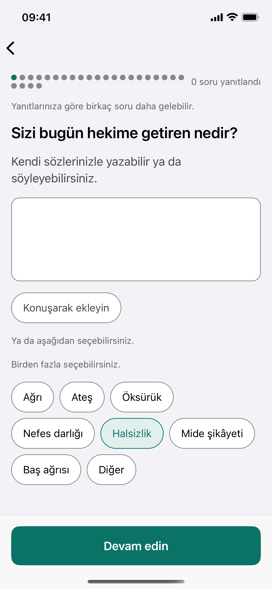
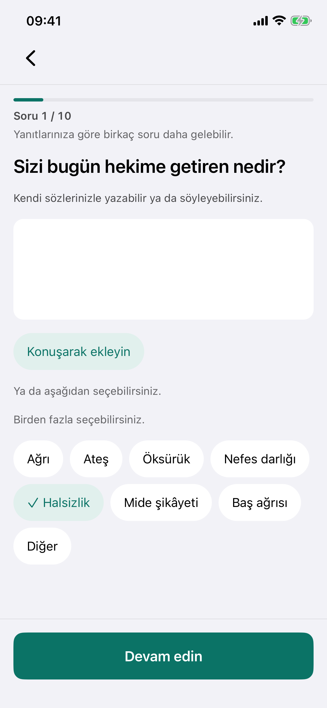

# Question screen: the native pass (INT-433)

| | |
|---|---|
| Issue | INT-433, GitHub #739. Owner review of the store shot, 2 Oct 2026 |
| Builds on | INT-422 (tokens, HIG type ramp) and INT-423 (materials on chrome only) |
| Screen | `apps/mobile/src/app/(tabs)/visits/[visitId]/intake.tsx` (typed steps) |
| Rules | `apps/mobile/src/lib/intake/questionScreen.ts`, held by `questionScreen.test.ts` and `e2e/questionScreen.spec.ts` |

## The ask

The owner reviewed the store capture of the typed question and found the design still not native enough. The capture showed a row of grey dots for progress, an outlined multi-line answer box, outlined pill chips, and a teal "Devam edin" button. He also asked for more Liquid Glass and a more Apple-like feel, and for Mobbin to be the reference.

## References (Mobbin, iOS)

| App and screen | What we took | What we left |
|---|---|---|
| [Apple Health, State of Mind: "What best describes this feeling?"](https://mobbin.com/screens/16c71fcb-dcf8-4d08-b423-675ef0449ea0) | Filled capsule chips with no outline, a secondary description under the heading, and one large rounded action at the bottom. | The warm full-bleed gradient. Our ground stays the grouped grey. |
| [Apple Health, Set up Health Details](https://mobbin.com/screens/280aa454-5521-4f6f-83ad-3bcb12bd682f) | Inputs drawn as filled grouped cells, identified by their fill and label, never by a box outline. | The inline label column. Our field answers one question, so the question is its label. |
| [Alan, "Anything else to share with your physiotherapist?"](https://mobbin.com/screens/d23d670e-0c7e-4143-b06f-538fa1b99a82) | A thin determinate bar at the top, chips with no outline, a multi-line field, and a pinned bottom action. This is the closest match to our screen. | The faint outline on the field. |
| [CVS Health, "Symptoms 1 of 4"](https://mobbin.com/screens/68a2e444-41e7-4588-8418-59a2e7198c6b) | The "N of M" counter, and a selected chip that carries a check, so its state is not colour alone. | The outlined chips. We kept the check and dropped the outline. |
| [MyFitnessPal, Goals](https://mobbin.com/screens/212f3e66-901d-4c1f-99c3-415a6f9c15b2) | A tinted fill for the selected chip. | Segmented progress. Detaylı reaches about thirty questions, and thirty segments become dots again. |
| [Hers, Consultation](https://mobbin.com/screens/f0a88993-c1f5-4e45-9945-c1e4c1b4da16) | A thin bar directly under the navigation bar and one question per screen. | The black CTA. Ours stays the app's one accent. |

Noom's diamond rail ([Mobbin](https://mobbin.com/screens/fa4294c6-027d-4463-9977-c416b24c8569)) is the counter-example. One mark per question is the dot row we are replacing.

## What changed

- **Progress.** `QuestionProgress` draws a 4 pt capsule track with a filled run, and under it the line "Soru 3 / 9" in Footnote with tabular figures.
  - Assistive technology gets one `progressbar` element whose value is "Soru 3, toplam 9".
  - M is the applicable count from the pack layer, never the pack's length.
  - While a gate could still add steps, the line "Yanıtlarınıza göre birkaç soru daha gelebilir." sits under the bar, outside the progressbar, so a reader hears it too.
- **Answer field.** The field is filled with `surface` and has no resting outline. A 2 pt tint ring shows while it is focused. The width is held in every state, so focusing never moves the text. Under Increase Contrast the resting field gets the `border` control boundary back, as iOS adds shapes to controls under that setting.
- **Chips.** Chips are filled capsules at least 44 pt tall. A selected chip is tinted (`primarySoft`), labelled in the tint, and draws an SF Symbol `checkmark` through the icon registry. The label wraps inside the capsule at every text step.
- **Chrome.** "Devam edin" rides the existing Liquid Glass bottom bar. The navigation bar now draws the same material: the header is transparent over `GlassNavBackground` (in `GlassBar.tsx`), and the content clears it by the header's own height.
  - Both bars ask the one glass policy: Liquid Glass on iOS 26, blur on older systems, and solid under Reduce Transparency.
  - With Reduce Transparency, the nav bar is the page ground, which is exactly the bar the screen had before.
  - When a warning banner sits above the steps, the bar stays solid, so nothing the warning says can sit under glass.
- **Content stays solid.** The screen itself draws no material. The question, field, chips and cards are on solid fills.
- **Type.** The question is Title 2 (`question` role, from INT-422). The hint is Footnote in the secondary label colour.
- **Smaller fills.** The dev voice-note button and the measure stepper's ± buttons lose their outlines too: the button is a tinted capsule and the ± buttons are filled.

## Constraints kept

- **Display-only numerals (invariant 22).** The numbers in "Soru N / M" are inserted at render. The catalogue holds only the words. `lib/intake/questionScreen.ts` and `QuestionProgress` are imported by the typed screen alone, and nothing on the spoken lane (DialogueIntake, `lib/dialogue`, `lib/livekit`) reaches them. VoiceOver reads the value, but that is the OS reader, not a protocol TTS.
- **No fixed promise.** INT-136 printed no total because "3 / 9" over a growing flow is a promise the next answer can break. The total is now the applicable count, and the growth line travels with it whenever a gate could still open (`typed_intake.spec.ts`).
- **Question text, instruments and RED.** The question renders `t(question.titleKey)` verbatim, and instrument steps still render through `InstrumentStep`. The screen paints no `emergency` token.
- **Contrast.** Every pair the redesign paints is checked in light, dark and Increase Contrast:
  - the selected label on its tint (AA);
  - the check and the focus ring (3:1);
  - the bar's fill on its track (3:1);
  - the count line and the field text (AAA).

  `theme.test.ts` is unchanged and green.
- **Dynamic Type.** The progress line fits a 375 pt phone at the largest step in both catalogues, measured in the shipped face (`overflow.spec.ts`). The chip bound now includes the check, sized to the label at the largest step (`typed_intake.spec.ts`).

## Field identification without an outline (SC 1.4.11)

A filled field on the grouped ground is identified by its fill and its position under the question and hint. While it is in use, the 3:1 focus ring identifies it. iOS's Increase Contrast restores the 3:1 `border` at rest.

The app's source gate bans the word that names TextInput's hint-text prop, so the field carries no in-field hint text. The hint line above it does that job instead.

## Captures

Both are iPhone 16e simulator captures (iOS 26.1, Expo Go, the synthetic dev account, status bar at 9:41).

| Before (INT-422/423 refresh, the store shot) | After |
|---|---|
|  |  |

- `after-question-typing-light.png`: the focused field, with a simulated-patient answer typed and a selected chip.
- `after-question-dark.png`: the same screen in dark mode.

The before capture is INT-425's `03-tek-soru.png` (PR #738), taken from the same flow.

Observed while capturing, and not changed here: in dark mode the native back chevron is not visible on pushed screens. The visit detail screen shows it too, and that screen's header this change does not touch.
