# Önvizit design system refresh (INT-422)

|             |                                                                                                                                                                                                                                         |
| ----------- | --------------------------------------------------------------------------------------------------------------------------------------------------------------------------------------------------------------------------------------- |
| Issue       | INT-422, GitHub #714. The owner's request on 27 Sep 2026 was that the app looked "too AI-generated". A follow-up direction asked for it to be warmer and friendlier too, without decorative flourishes.                                 |
| Scope       | Tokens (`apps/mobile/src/lib/theme.ts`), the shared components and the Increase Contrast store. Screens change only through those, apart from four question sites (role only) and two empty states. **No copy changed. No i18n edits.** |
| Not touched | RED and red-flag surfaces and their colours (ADR-033 §5, invariant 21). Legal and consent text rendering. Question text. Motion tokens.                                                                                                 |
| Authority   | `files/00_STATE.md` > `files/02` > this document. It supersedes the visual register of [mobile-ui.md](mobile-ui.md) (the "Oura register", design passes 3 to 6). Its accessibility and Turkish rules stand.                             |

## 1. What read as generated, and what replaced it

| Before                                                                                       | After                                                                                                                                            | Why                                                                                                                   |
| -------------------------------------------------------------------------------------------- | ------------------------------------------------------------------------------------------------------------------------------------------------ | --------------------------------------------------------------------------------------------------------------------- |
| Warm paper ground `#FAF8F4`, cards floating on an 18 pt soft shadow                          | iOS grouped grounds: `#F2F2F7` ground, white cells, no shadow. Dark mode is `#000` and `#1C1C1E`.                                                | Tonal grouping is how iOS separates content. A shadow under every card is the most recognisable generated-UI tell.    |
| A primarySoft-to-transparent gradient "glow" on the hero visit card (`expo-linear-gradient`) | The same grouped cell as every other card                                                                                                        | No gradient exists anywhere in the app now, and a guard pins that.                                                    |
| Newsreader serif display plus Inter body, bundled and loaded behind the splash               | The platform face: SF Pro on iOS, the system sans on Android. SF Pro Rounded for the screen's Large Title and the one numeral.                   | Native type, Dynamic Type sizes and optical sizing, with nothing to download or wait for. Rounded is the warmth (§4). |
| 24 and 32 pt card corners, pill-shaped (999) buttons and inputs                              | One 12 pt radius with `borderCurve: "continuous"` (the iOS squircle). Capsules only for small tags and the tab rail.                             | Oversized round cards were the second tell.                                                                           |
| Tracked, dotted "kicker" eyebrows                                                            | A sentence-case semibold Footnote section header                                                                                                 | Apple list headers are quiet and untracked. Turkish case transforms stay banned (İ/ı).                                |
| Neutral black (or bone) pill as the focal CTA                                                | The tinted filled button (`.borderedProminent`) in the one teal accent. Secondary actions are the grey button with a tinted label (`.bordered`). | One accent, spent on the action.                                                                                      |
| 36 pt beige icon wells in list rows, and a 56 pt outlined box around primer marks            | A bare SF Symbol in the tint, as UIKit list cells and Apple's privacy primers draw them                                                          | The tinted glyph is the anchor, and the box added nothing.                                                            |
| Inverted black slab for the selected segment                                                 | The iOS segmented control: a raised thumb with a 3:1 edge and a semibold label                                                                   | Native control, and the selection never rests on colour alone.                                                        |
| Glass on a dev-only welcome card (`GlassCard`)                                               | Removed. Glass now lives only on the tab rail and the bottom bar.                                                                                | HIG: materials belong to the functional layer, never to content.                                                      |

## 2. Tokens

**Colour.** `theme.ts` keeps the component vocabulary (`ink`, `inkSoft`, `surface`, …). Each token names its UIKit semantic colour and its Material 3 role in `SYSTEM_ROLES`:

| Token                  | iOS                              | Android                 |
| ---------------------- | -------------------------------- | ----------------------- |
| `background`           | systemGroupedBackground          | surfaceContainer        |
| `surface`              | secondarySystemGroupedBackground | surfaceContainerLowest  |
| `surfaceRaised`        | systemGray5                      | surfaceContainerHighest |
| `ink`                  | label                            | onSurface               |
| `inkSoft` / `inkFaint` | secondaryLabel / tertiaryLabel   | onSurfaceVariant        |
| `border`               | (a control boundary)             | outline                 |
| `separator`            | opaqueSeparator                  | outlineVariant          |
| `primary` / `cta`      | tintColor                        | primary                 |

- **Apple's exact values.** The grounds, the label and the separator use them in both schemes, and `theme.test.ts` pins those.
- **Where the values move.** `secondaryLabel` and `tertiaryLabel` are translucent in UIKit and measure about 3.4:1 and 1.9:1 on white, below this app's floors. Here they are opaque and darker. They keep their role and their order.
- **Why hex rather than `PlatformColor`.** The patient's in-app theme (INT-260) can differ from the OS one, and a system colour would follow the OS. A system colour also cannot be measured in node, which is where the contrast floors are enforced.
- **Increase Contrast.** iOS Increase Contrast and Android High contrast text select `highContrastPalette`. It keeps the same grounds, with stronger text, boundaries, separators and accent. The setting is read through one fail-soft store (`lib/a11y/contrast.ts`, native adapter loaded lazily) and applied in `useTheme()`, so every surface follows it live.

**Type.** The roles are rungs of Apple's Dynamic Type ladder at the Large size:

- `hero`: Large Title 34, bold, rounded.
- `question`: Title 2 22, semibold. It is new, for the one question on an intake step.
- `title`: Title 3 20, semibold.
- `body`: Body 17.
- `label`: Subheadline 15.
- `caption`: Footnote 13.
- `micro`: Caption 2 11, chrome only.
- `display`: 56, SF Pro Rounded. It is the one numeral.

The scale and the 2.0 clamp are unchanged (INT-260).

**Grid and corners.** Spacing is 4, 8, 16, 24 and 32, and the screen margin is 16, the iPhone readable margin. Every container and control has a 12 pt continuous corner.

**Materials.** Liquid Glass (iOS 26) or blur (elsewhere) appears on the tab rail and the bottom CTA bar only. Reduce Transparency, or an unanswered OS, gives solid `surface` (INT-412's `glassMode`, unchanged).

## 3. Accessibility, tested

- **Contrast** (`theme.test.ts`), in light, dark and both Increase Contrast palettes:
  - every text pair the app sets meets AA (4.5:1);
  - clinical text (`ink`, and `inkSoft` on the grounds) meets AAA (7:1);
  - control boundaries and fills meet 3:1 (SC 1.4.11);
  - Increase Contrast never weakens a pair.
- **INT-144's open gaps closed.** The two SC 1.4.3 pairs (`inkFaint` on light grounds, the light "Dosyaya eklendi" chip) and the SC 1.4.11 chip boundary are closed. The conformance report was re-rendered from its YAML source.
- **Dynamic Type to AX5.** `e2e/designSystem.spec.ts` reads React Native's own content-size multipliers, AX1 to AX5 included. It proves that every word of every question, in both catalogues, keeps its line on a 375 pt iPhone at every size, and that nothing on the question's path can truncate a line. The measure uses Inter SemiBold as an upper bound for SF Pro Semibold (CoreText measured SF at 0.92 of it; see `docs/evidence/INT-422.md`).
- **Near miss.** At the Large Title size the same words do break, which is why questions take the Title 2 rung.
- **Reduce Transparency** falls back to solid. That is INT-412's policy, and the only two glass hosts are pinned.

## 4. Warmer and friendlier, without decoration (owner follow-up)

- **Rounded titles.** Each screen's Large Title and the one numeral are set in SF Pro Rounded (SwiftUI's `.fontDesign(.rounded)`). It is a face, not an ornament.
- **Colour that orients.** The teal tint now marks what is actionable or active: the tab bar's current section, list-row glyphs, the primer marks, the progress arc and the focal button. Everything else is quiet neutrals.
- **Empty states with a next step.** `EmptyState` follows ContentUnavailableView: a tinted SF Symbol, the line the screen already had, and its one action. Bugün with no visit and Vizitlerim with no visits use it. The first replaced a grey card saying "nothing here" with a dot-eyebrow above it.
- **Clearer hierarchy.**
  - One Large Title per screen.
  - Footnote section headers.
  - Body-size cells on grouped grounds.
  - One filled button per screen.
  - Secondary actions in grey.
- **Microcopy placement.** Group footers (`ListGroup footer`) carry the explanatory line under the group it explains, in the iOS footer style. No sentence was rewritten (copy belongs to INT-414).

## 5. Before and after (iPhone 16e simulator, iOS 26.1, Expo Go)

"Before" is `origin/main` at `79ba5659`, run from a clean export of `apps/mobile`. "After" is this branch. Both are at the default text size.

| Screen                | Before                                                | After                                                |
| --------------------- | ----------------------------------------------------- | ---------------------------------------------------- |
| Welcome               | 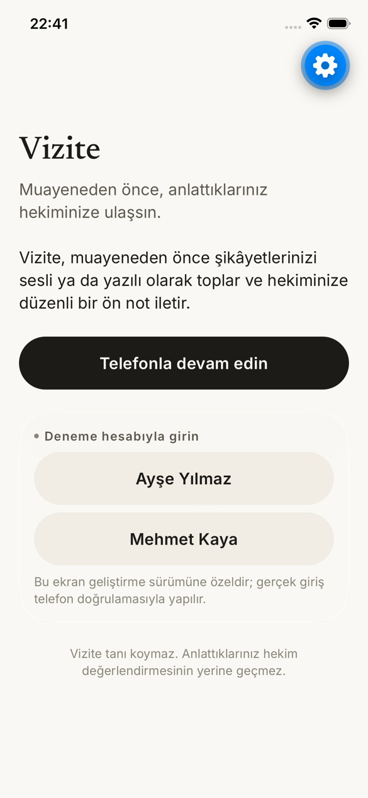       | 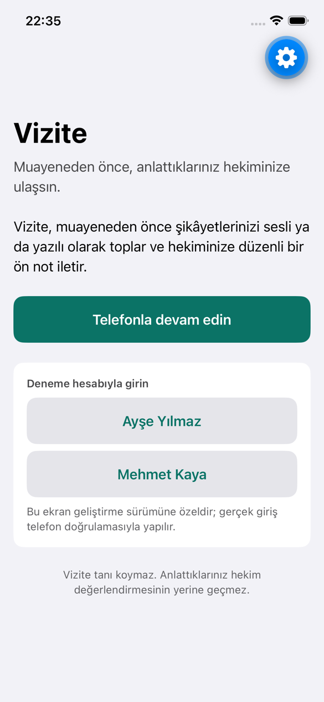       |
| Bugün                 | 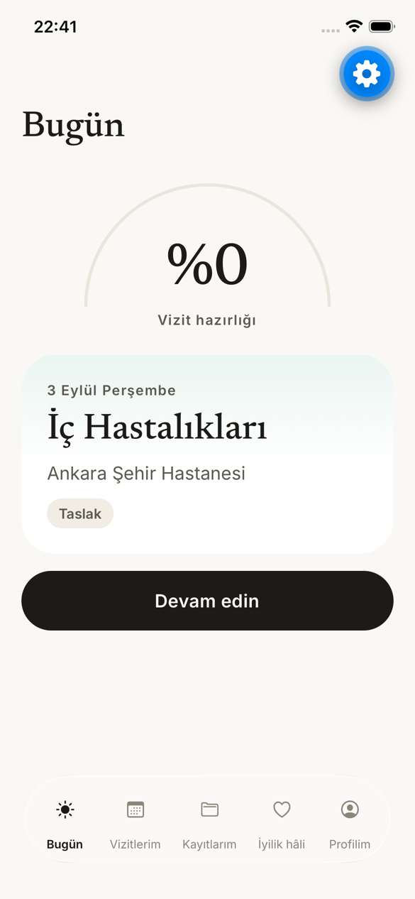         | 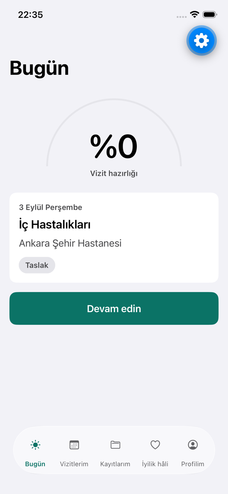         |
| Vizitlerim            | 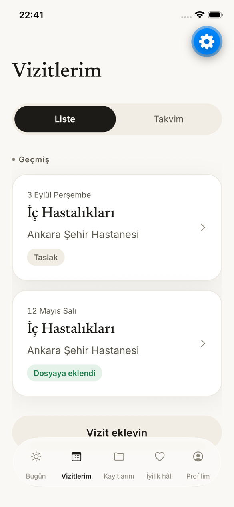        | 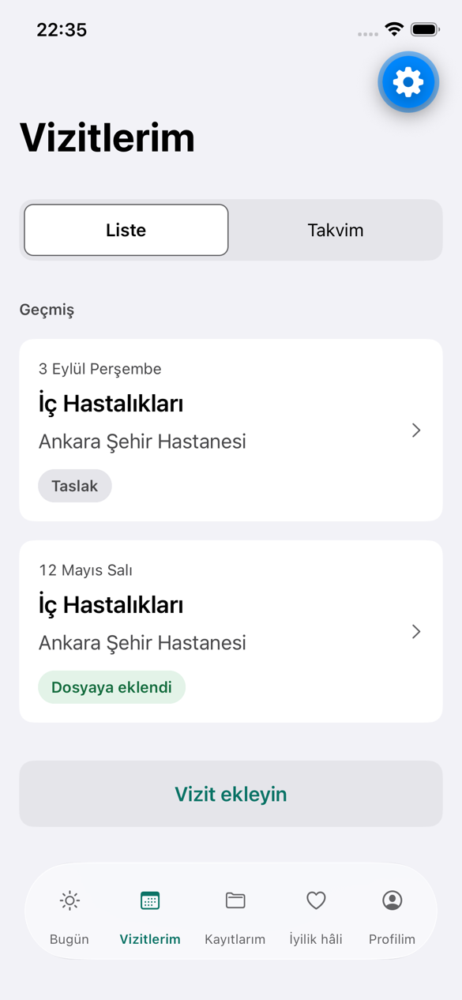        |
| Kayıtlarım            | 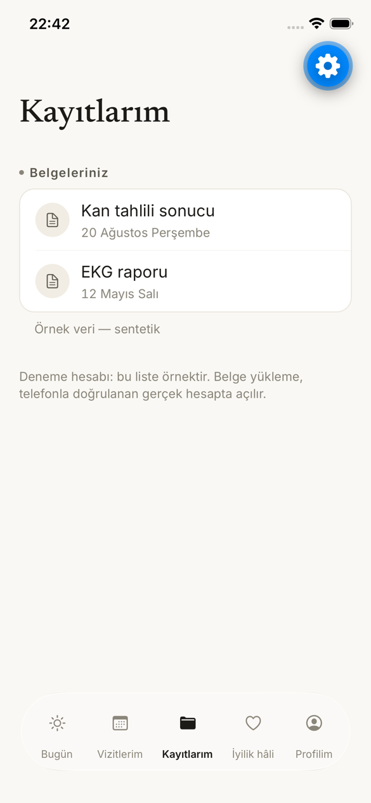       | 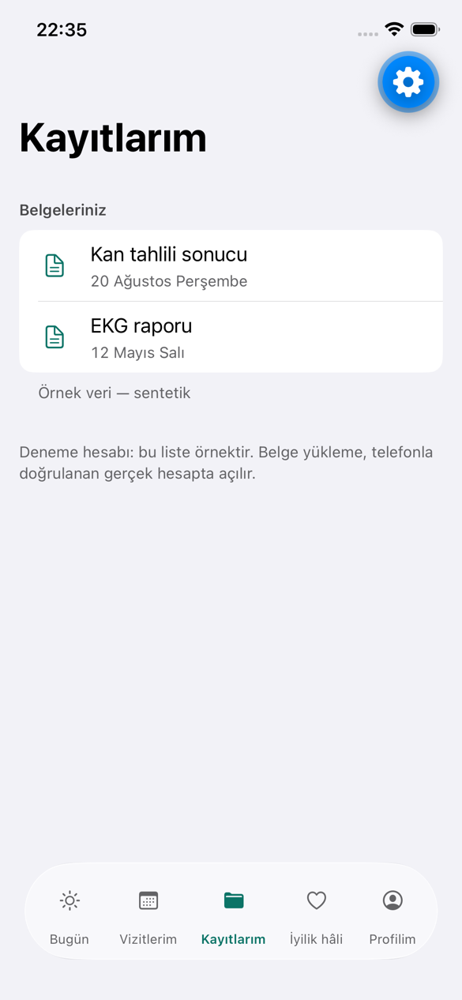       |
| Profilim              | 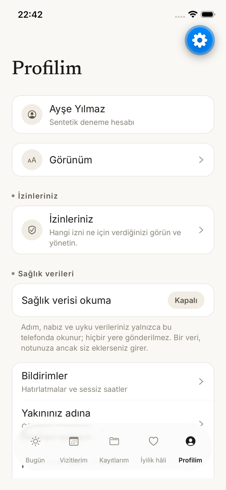       | 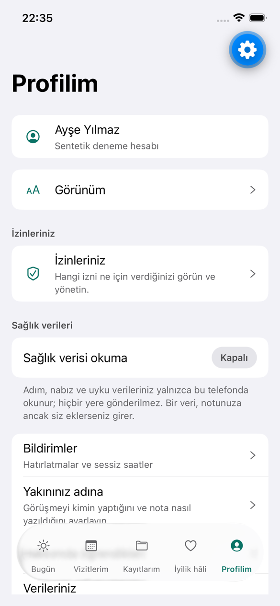       |
| Profilim (lower)      | 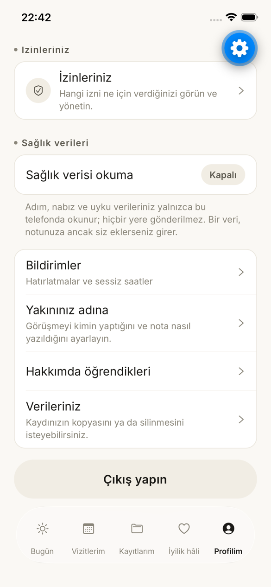 | 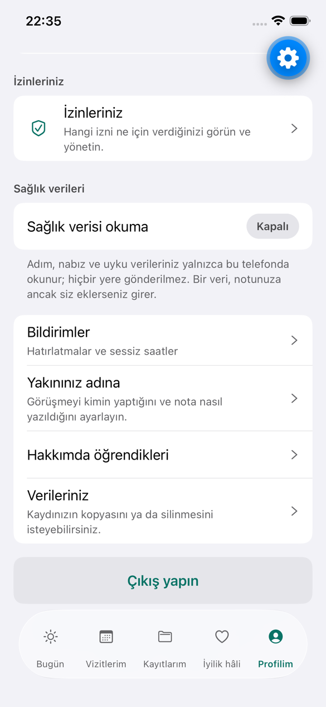 |
| Verileriniz (DSAR)    | 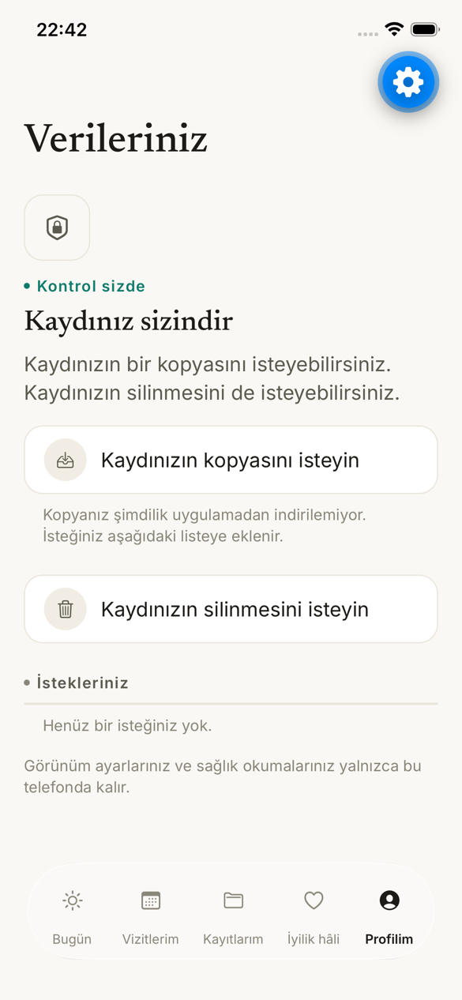          | 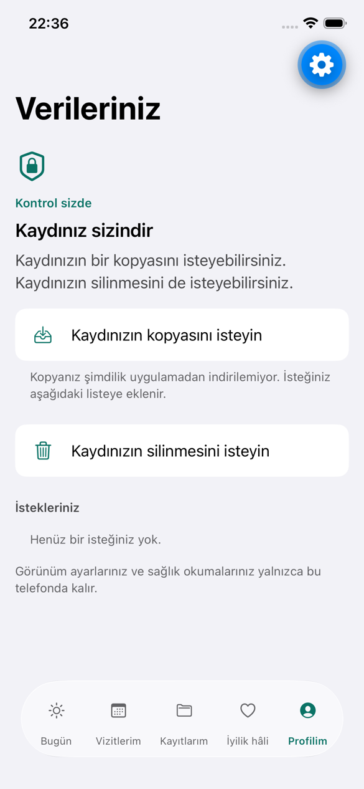          |
| Visit detail          | 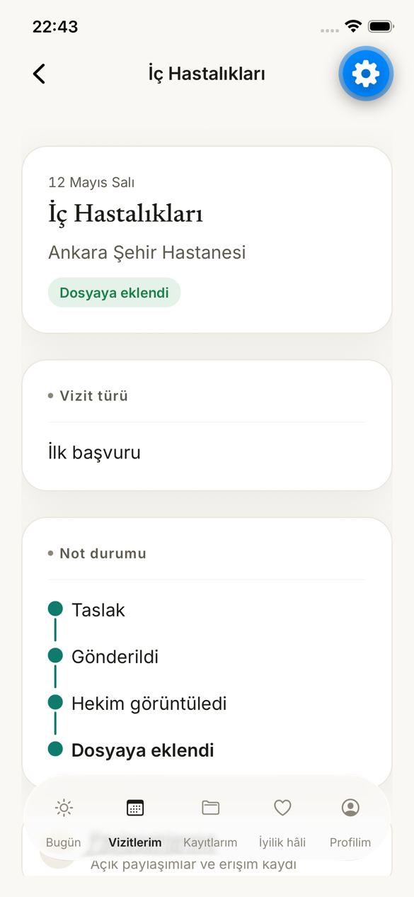  | 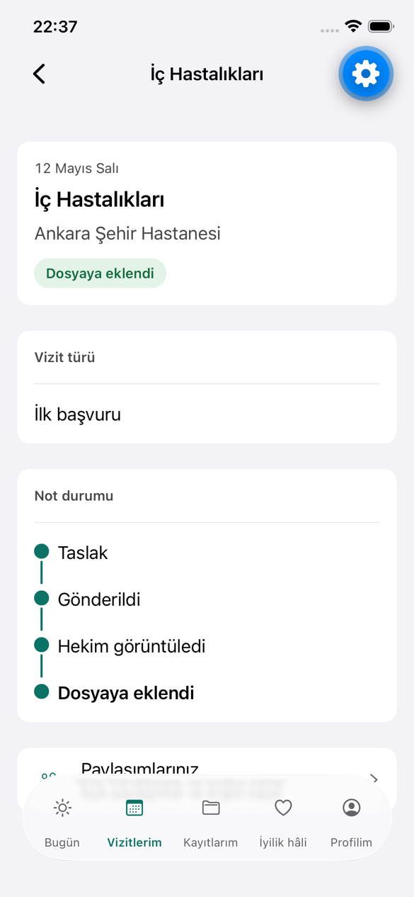  |
| Paylaşımlarınız       | 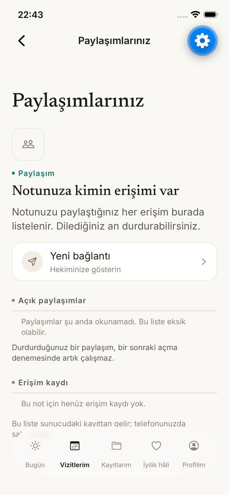        | 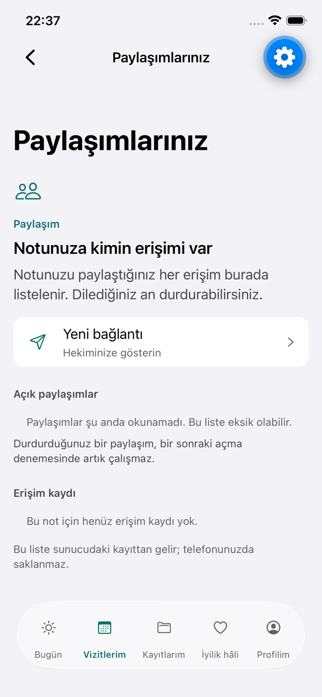        |
| Paylaşımlarınız, dark | 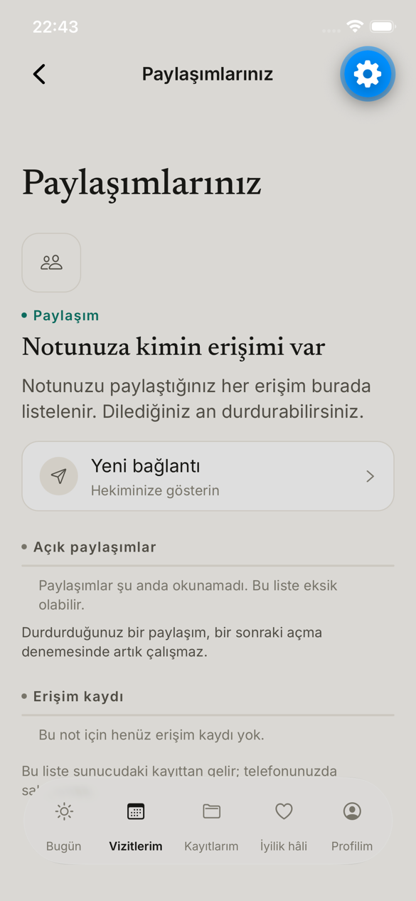         | 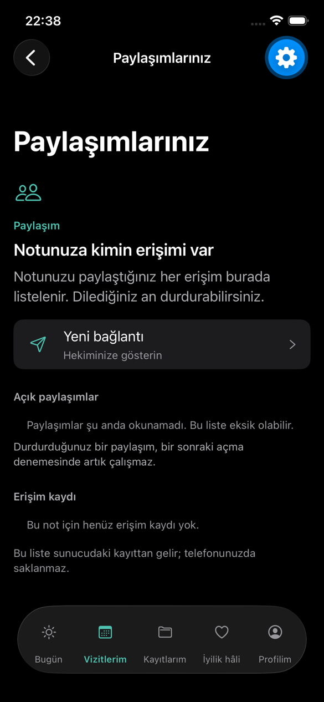         |
| Bugün, dark           | 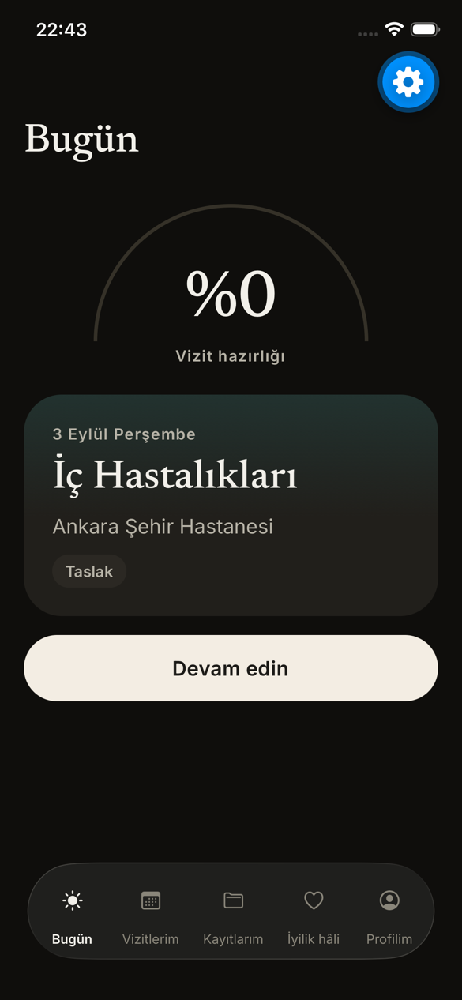          | 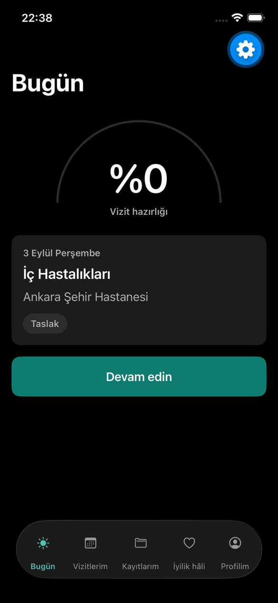          |

After only:

- The intake question, light ([after-11](system-refresh/after-11-intake-question-light.png)) and dark ([after-12](system-refresh/after-12-intake-question-dark.png)).
- Hakkımda öğrendikleri ([after-08](system-refresh/after-08-learned-light.png)).

The "before" intake capture was lost with the first session's scratch files. The intake used the same Newsreader hero and pill controls as the other "before" screens.

The blue gear at the top right is Expo Go's developer-menu button, not app chrome.

## 6. Logo

Unchanged. The V-mark and the icon assets belong to INT-420 (the Önvizit rebrand), which ports them, and the app source draws no logo. The mark is two filled capsules with no hairlines or gradients. That construction is the one that survives small sizes, so this issue did not redraw it. A small-size check of the shipped icon belongs with INT-420's Icon Composer steps (`apple-native/icon/README.md`).

## 7. For the App Store captures

The refreshed look has no load-dependent fonts and no animated decoration, so a capture is deterministic once the bundle has loaded. Capture with Reduce Transparency off, to show the glass rail, and at the default text size.
